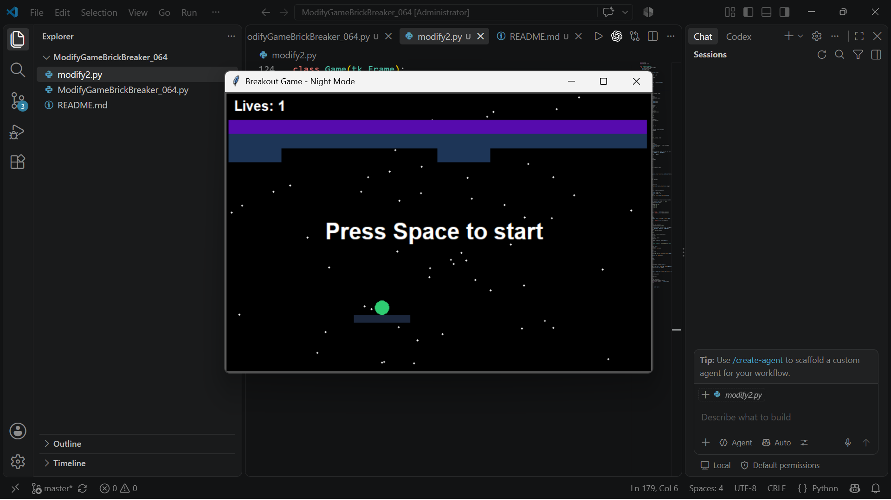

# balok pemantul diubah menjadi warna night blue atau biru gelap
def __init__(self, canvas, x, y):
    self.width = 80
    self.height = 10
    self.ball = None
    # balok pemantul diubah menjadi warna night blue
    item = canvas.create_rectangle(
        x - self.width / 2,
        y - self.height / 2,
        x + self.width / 2,
        y + self.height / 2,
        fill='#1b263b',
        outline='#1b263b',
    )
    super(Paddle, self).__init__(canvas, item)

  def set_ball(self, ball):
    self.ball = ball

  def move(self, offset):
    coords = self.get_position()
    width = self.canvas.winfo_width()
    if coords[0] + offset >= 0 and coords[2] + offset <= width:
      super(Paddle, self).move(offset, 0)
      if self.ball is not None:
        self.ball.move(offset, 0)

class Brick(GameObject):
  # Balok yang dihancurkan diganti menjadi warna biru tua dan ungu
  COLORS = {1: '#1d3557', 2: '#560bad', 3: '#7209b7'}

  def __init__(self, canvas, x, y, hits):
    self.width = 75
    self.height = 20
    self.hits = hits
    color = Brick.COLORS[hits]
    item = canvas.create_rectangle(
        x - self.width / 2,
        y - self.height / 2,
        x + self.width / 2,
        y + self.height / 2,
        fill=color,
        outline=color,
        tags='brick',
    )
    super(Brick, self).__init__(canvas, item)

  def hit(self):
    self.hits -= 1
    if self.hits == 0:
      self.delete()
    else:
      self.canvas.itemconfig(self.item, fill=Brick.COLORS[self.hits])

# background diubah menjadi warna hitam dan ditambah titik titik putih
class Game(tk.Frame):

  def __init__(self, master):
    super(Game, self).__init__(master)
    self.lives = 3
    self.width = 610
    self.height = 400

    # Background di ubah menjadihitam
    self.canvas = tk.Canvas(
        self, bg='#000000', width=self.width, height=self.height
    )
    self.canvas.pack()
    self.pack()

    # Menambah titik-titik putih di background hitam
    for _ in range(60):
      rx = random.randint(5, self.width - 5)
      ry = random.randint(5, self.height - 5)
      self.canvas.create_oval(
          rx, ry, rx + 2, ry + 2, fill='white', outline='white'
      )

    self.items = {}
    self.ball = None
    self.ball_color_index = 0  # Indeks untuk perputaran warna bola

    self.paddle = Paddle(self.canvas, self.width / 2, 326)
    self.items[self.paddle.item] = self.paddle

# mengubah warna bola saat dia mati atau jatuh sesuai urutan merah, kuning, hijau, biru muda
def add_ball(self):
    if self.ball is not None:
      self.ball.delete()
    paddle_coords = self.paddle.get_position()
    x = (paddle_coords[0] + paddle_coords[2]) * 0.5

    # Bola berubah warna berurutan (Merah, Kuning, Hijau, Biru Muda)
    ball_colors = ['#e74c3c', '#f1c40f', '#2ecc71', '#00bcd4']
    chosen_color = ball_colors[
        self.ball_color_index % len(ball_colors)
    ]
    self.ball_color_index += 1

    self.ball = Ball(self.canvas, x, 310, chosen_color)
    self.paddle.set_ball(self.ball)

Apa saja yang diubah
1.balok pemantul diubah menjadi warna night blue atau biru gelap
2.Balok yang dihancurkan diganti menjadi warna biru tua dan ungu
3.background diubah menjadi warna hitam dan ditambah titik titik putih
4.mengubah warna bola saat dia mati atau jatuh sesuai urutan merah, kuning, hijau, biru muda